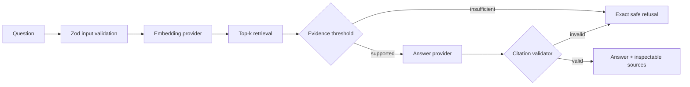

# Grounded Knowledge Assistant

[](https://github.com/Billyflin/grounded-knowledge-assistant/actions/workflows/ci.yml)
[](https://billyflin.dev)

A compact RAG engineering reference that retrieves evidence, generates source-grounded answers, validates citation markers, and refuses unsupported questions. It runs locally and in CI without an API key; an optional OpenAI adapter demonstrates the hosted-provider boundary.

> Independent technical evidence by Billy Martínez. This is not a claim of client work, production RAG ownership, or employer experience. All included documents are synthetic and original to this repository.

## What this demonstrates

- A typed Next.js 16 / TypeScript request path from UI to server-only retrieval.
- Deterministic hashed embeddings for fast, zero-key tests and evaluations.
- Optional OpenAI embeddings and Responses API providers behind narrow interfaces.
- Fail-closed behavior for weak retrieval and absent or invented citations.
- Untrusted-context boundaries, sanitized API errors, and no browser-side secrets.
- Repeatable retrieval hit@3, support/refusal, and citation-validity evaluation.

## Request flow



The same pipeline runs with either provider pair:

| Mode | Embeddings | Answers | API key | Intended use |
| --- | --- | --- | --- | --- |
| `local` | deterministic hashed token vectors | extractive sentence selection | no | development, CI, control-flow evidence |
| `openai` | `text-embedding-3-small` by default | Responses API with `gpt-5.4-mini` by default | yes | optional integration path |

The local provider is deliberately small. It is not presented as a replacement for semantic embeddings or a quality claim about a production system.

## Run locally

Requirements: Node.js 24+ and pnpm 11.

```bash
pnpm install
pnpm dev
```

Open `http://localhost:3000`. The default mode requires no environment variables.

To use the optional hosted provider:

```bash
cp .env.example .env.local
# Add OPENAI_API_KEY and set RAG_PROVIDER=openai.
pnpm dev
```

`OPENAI_API_KEY` is read only by the server runtime. Never expose it through a `NEXT_PUBLIC_` variable or commit `.env.local`.

## Verify the evidence

```bash
pnpm verify
```

The command runs linting, strict type checking, unit and adversarial tests, deterministic evaluations, and the production build. CI executes the same command on pushes and pull requests.

The test suite covers:

- chunk overlap and metadata integrity;
- expected-document retrieval;
- grounded answers with known citations;
- exact refusal for unsupported questions;
- blocking answers that invent a citation;
- treating prompt-like source content as data, not instructions.

The evaluation script prints every case and fails unless retrieval hit@3, support/refusal accuracy, and citation validity are all 100% on the committed fixture set. These are repository-fixture metrics, not production quality metrics.

| Committed-fixture check | Result |
| --- | ---: |
| Automated tests | 12 / 12 |
| Retrieval hit@3 | 100% (6 / 6) |
| Support/refusal accuracy | 100% (8 / 8) |
| Citation validity | 100% (8 / 8) |

## Human-verified AI-assisted delivery

AI tools may accelerate research, implementation, test design, and review in this repository, but they do not approve their own output. Every accepted change must remain explainable by a human reviewer and pass the same evidence gates regardless of how it was produced:

1. state the behavior or risk being changed;
2. add or identify a reproducible test or evaluation case;
3. inspect the complete diff for correctness, security, and unintended scope;
4. run `pnpm verify` and report failures instead of hiding them;
5. preserve explicit limitations and never turn fixture results into production claims.

Generated code is treated like an untrusted third-party contribution. Secrets, confidential source material, and personal data are outside the allowed prompting boundary. The repository's [pull request template](.github/pull_request_template.md) makes the evidence and review record visible, while [ADR 003](docs/adr/003-human-verified-ai-delivery.md) explains the trade-offs.

## Design and security decisions

- [ADR 001: provider boundary](docs/adr/001-provider-boundary.md)
- [ADR 002: grounding controls](docs/adr/002-grounding-controls.md)
- [ADR 003: human-verified AI-assisted delivery](docs/adr/003-human-verified-ai-delivery.md)
- [Security policy and properties](SECURITY.md)

The hosted answer provider sends only the question and the retrieved excerpts, sets response storage to false, tells the model to treat the delimited context as untrusted, and requires known `[S#]` markers. The server independently validates those markers before returning the answer.

Important limitations:

- Syntactically valid citations are not proof of claim-level entailment.
- The in-memory index is appropriate only for this small fixture set.
- There is no authentication, tenant isolation, rate limiting, or persistent audit log.
- Thresholds must be calibrated against representative domain data before use.
- A production design needs quality, latency, cost, abuse, privacy, and failure-mode monitoring.

## Project map

```text
app/                 Next.js UI, source pages, and POST /api/ask
data/                synthetic operational knowledge base
lib/rag/             chunking, retrieval, providers, gates, validation
tests/               deterministic and adversarial test suite
evals/               committed quality cases and metrics
docs/adr/            architectural decisions and trade-offs
```

## Official API references

- [OpenAI quickstart](https://platform.openai.com/docs/quickstart/make-your-first-api-request)
- [Responses API reference](https://developers.openai.com/api/reference/typescript/resources/beta/subresources/responses/methods/create)

## License

[MIT](LICENSE)
